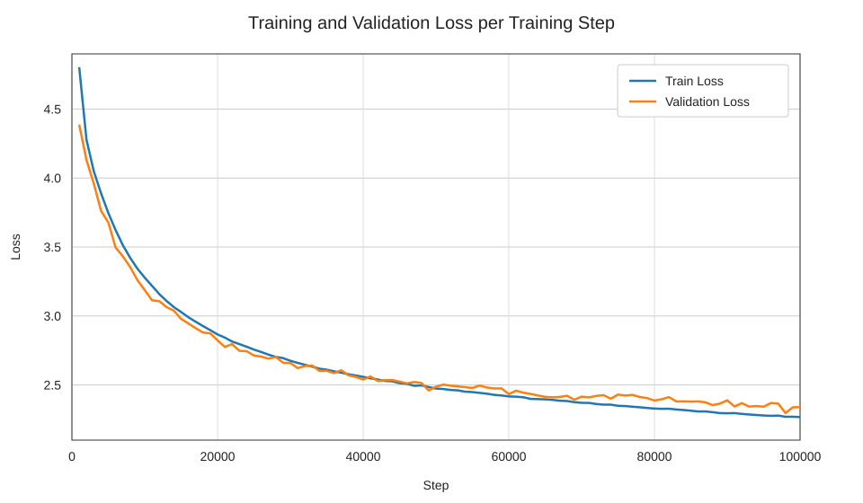
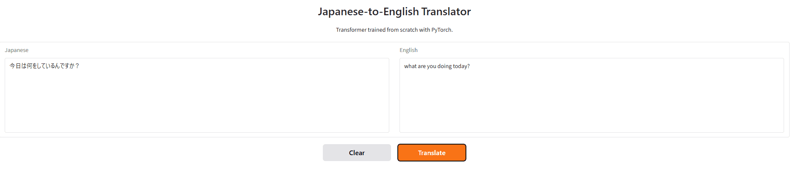

# Japanese-to-English Translation with Transformer

A Japanese-to-English neural machine translation project built from scratch with PyTorch. It uses an encoder–decoder Transformer trained on the [JESC dataset](https://huggingface.co/datasets/nntsuzu/JESC).

The goal is to understand and implement the full machine translation pipeline, from tokenization and model training to evaluation and autoregressive inference.

## Features

- Byte-level BPE tokenizer trained on Japanese and English text
- Encoder–decoder Transformer with self-attention and cross-attention
- Teacher forcing during training and greedy decoding for inference
- Training and validation loss logging to CSV
- Dataset caching and model checkpoints

## Training Results

A larger Pre-LN Transformer was trained from scratch on an NVIDIA GeForce RTX 5090 for 100,000 optimization steps.



| Model | Final train loss | Final validation loss |
| --- | ---: | ---: |
| Small Transformer | 3.1399 | 3.0313 |
| Large Pre-LN Transformer | 2.2672 | 2.3394 |

Both runs used 100,000 steps, with batch sizes of 128 and 256 respectively. The larger run achieved a 22.8% lower final validation loss; this comparison does not isolate the effect of model size.

## Translation Examples

Actual greedy-decoding outputs from the larger model (unedited):

| Japanese input | English output |
| --- | --- |
| こんにちは | hello! |
| 空が青い | the sky is blue |
| 何をしているんですか？ | what are you doing? |
| 私の名前は太郎です | my name is taro |
| 月がきれいですね | the moon is beautiful |

The model handles many everyday expressions, but short inputs and literary language can still produce incorrect translations. These examples are qualitative; corpus-level translation metrics are planned.

## Translation Demo

The trained Transformer model can be integrated with Gradio to build a simple web-based Japanese-to-English translation system. Users can enter Japanese text and translate it into English through a straightforward interface.



## Model Configuration

| Setting | Value |
| --- | --- |
| Embedding dimension | 512 |
| Attention heads | 8 |
| Encoder / decoder layers | 6 / 6 |
| Feed-forward dimension | 2,048 |
| Dropout | 0.1 |
| Maximum sequence length | 128 tokens |
| Optimizer | AdamW |
| Normalization | Pre-LN |
| Batch size | 256 |
| Training steps | 100,000 |
| Compilation | torch.compile (dynamic shapes) |

These are the settings reported for the larger RTX 5090 experiment above. The checked-in training script currently uses a smaller baseline configuration; adjust the training and model settings to reproduce the larger run.

## Getting Started

Run all commands from the repository root.

```bash
git clone https://github.com/Manstein0704/-Japanese-to-English-translation.git
cd -- -Japanese-to-English-translation
python -m venv venv
source venv/bin/activate
pip install torch datasets tokenizers numpy
```

### 1. Prepare the Tokenizer

```bash
PYTHONPATH=src python -m translator.tokenizer
```

The tokenizer is saved to `artifacts/tokenizer.json`. The dataset is downloaded or loaded from a local cache during preparation.

### 2. Train the Model

```bash
CUBLAS_WORKSPACE_CONFIG=:4096:8 PYTHONPATH=src python -m translator.train
```

The training script records training and validation losses in `outputs/train_loss.csv` and saves a checkpoint after training finishes. Training settings, including the number of steps, are configured in `src/translator/train.py`.

### 3. Translate Text

After training, set `CHECKPOINT_PATH` in `src/translator/translate.py` to an existing checkpoint and ensure the model configuration matches the checkpoint.

```bash
PYTHONPATH=src python -m translator.translate
```

Enter Japanese text at the prompt. Type `quit` to exit.

## Project Structure

```text
src/translator/
├── data.py        # JESC loading, caching, and batches
├── tokenizer.py   # BPE tokenizer training
├── model.py       # Encoder–decoder Transformer
├── train.py       # Training and checkpointing
├── evaluate.py    # Validation loss
└── translate.py   # Greedy autoregressive decoding
```

## Status

This is an experimental learning project. Translation quality is still being evaluated and improved; no production-level accuracy is claimed.

## Dataset

[JESC (Japanese–English Subtitle Corpus)](https://huggingface.co/datasets/nntsuzu/JESC), a parallel corpus derived from subtitles.
